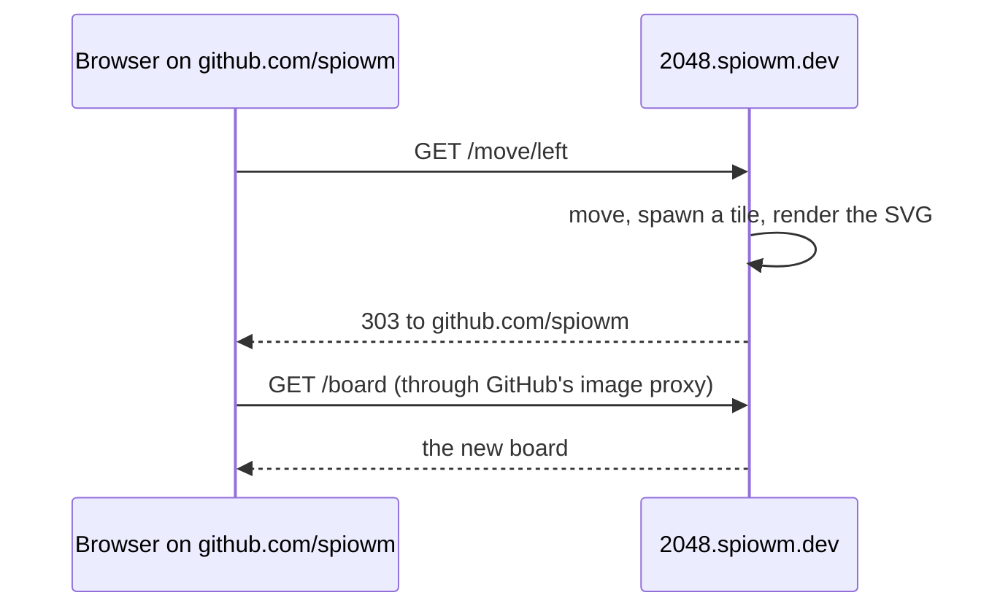

<p align="center">
  
</p>

<h1 align="center">readme-2048</h1>

<p align="center">A 2048 game that everyone plays together on my <a href="https://github.com/spiowm">GitHub profile</a>.<br>Like the monobank version, a game ends as soon as a 2048 tile appears.</p>

<p align="center">
  
  
  
</p>

## How it works

A GitHub README can't run JavaScript, but it can show images and links. So the board is an image served by this app, and each arrow is a plain link that makes a move and sends you back to the profile.



- **Speed.** A move with rendering takes about 30 µs, and the SVG is rendered once per move and kept in memory. Almost all of the delay a player sees is GitHub reloading the profile page.
- **Fresh image.** `/board` is sent with `Cache-Control: no-cache, no-store`, so GitHub's image proxy (camo) fetches it on every page view. The path has no `.svg` extension, and the domain is not behind a CDN cache.
- **One board for everyone.** Images in a README go through camo without cookies, so there is no way to tell players apart on the image side.
- **Abuse.** Each player can move at most once every 0.3 s, known bots and link previews are ignored, and `robots.txt` disallows everything. Players are counted by a salted hash of the IP address; raw IPs are never stored.
- **Rules.** The move logic matches [2048-solver](https://github.com/spiowm/2048-solver) on 50,000 random boards. A tile is 2 with probability 0.9 and 4 otherwise.

| Endpoint | |
| --- | --- |
| `GET /board` | Current board as SVG |
| `GET /move/{left,up,down,right}` | Make a move and redirect to `PROFILE_URL` |
| `GET /stats?token=…` | Board views, moves and players per day |
| `GET /health` | Liveness check |

## Run locally

```bash
uv sync
cp .env.example .env    # set PLAYER_SALT, and DB_PATH to a local file
uv run --env-file .env uvicorn app.main:app --reload
```

The board is at http://127.0.0.1:8000/board. Requests whose User-Agent looks like a script (curl, python) don't count as moves, so test moves from a browser.

## Deploy

```bash
docker build -t readme-2048 .
docker run -p 8000:8000 -v readme-2048:/data --env-file .env readme-2048
```

Mine runs on Coolify with a persistent volume at `/data`. The settings are in [`.env.example`](.env.example).

## License

MIT
