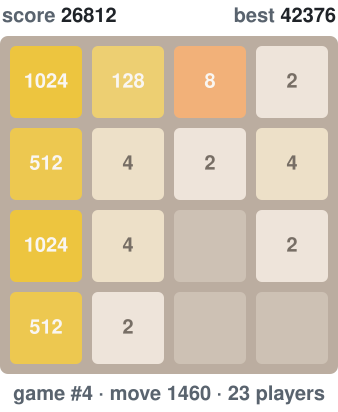
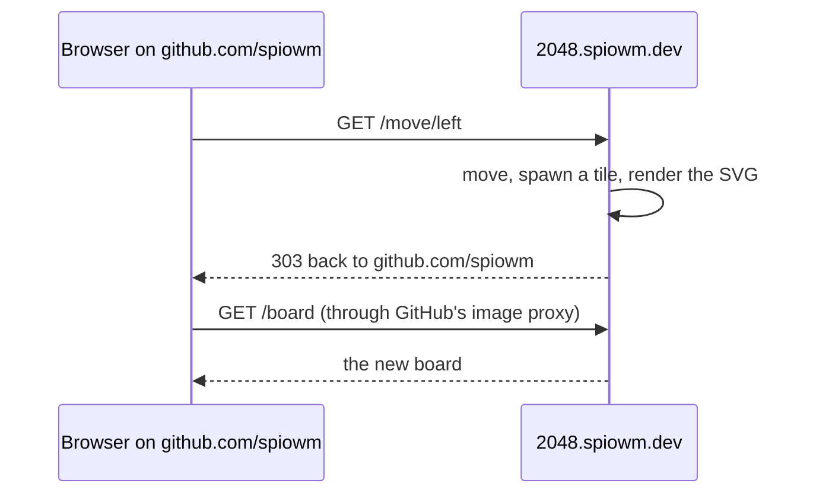

<p align="center">
  
</p>

<h1 align="center">readme-2048</h1>

<p align="center">A 2048 game that everyone plays together on my <a href="https://github.com/spiowm">GitHub profile</a>.<br>Like the monobank version, a game ends as soon as a 2048 tile appears.</p>

<p align="center">
  <a href="https://github.com/spiowm/readme-2048/actions/workflows/ci.yml"></a>
  
  
  
</p>

## How it works

A GitHub README can't run JavaScript, but it can show images and links. So the board is an image served by this app, and each arrow is a plain link that makes a move and sends you back to the profile.



- **Speed.** A move with rendering takes about 30 µs, and the SVG is rendered once per move and kept in memory. Almost all of the delay a player sees is GitHub reloading the profile page.
- **Fresh image.** `/board` is sent with `Cache-Control: no-cache, no-store`, so GitHub's image proxy (camo) doesn't keep a copy and asks the server again on each profile view. The path has no `.svg` extension. The domain sits behind Cloudflare as a proxy only (`cf-cache-status: DYNAMIC`): camo then connects to a nearby Cloudflare node instead of opening a new connection to the server, which cut about 350 ms per board.
- **One board for everyone.** Images in a README go through camo without cookies, so there is no way to tell players apart on the image side.
- **Moves that change nothing.** If the board can't move that way, the server answers `204 No Content` and the browser stays on the page. The exception is a click on an outdated board: if someone else has moved since your last click, you get the redirect, so the page reloads with the current position.
- **Abuse.** Each player can move at most once every 0.3 s. Prefetches (`Sec-Fetch-Mode` other than `navigate`), link previews and known bots don't move, and `robots.txt` disallows everything. Players are counted by a salted hash of the IP address, and `CF-Connecting-IP` is trusted only when the request really comes from a Cloudflare address. Raw IPs are never stored.
- **State.** A move is computed on a copy and replaces the live board only after the state and the move are committed to SQLite in one transaction. Board views are counted in memory and written once a minute, so serving the image never waits on the database.
- **Rules.** The move logic matches [2048-solver](https://github.com/spiowm/2048-solver) on 50,000 random boards. A tile is 2 with probability 0.9 and 4 otherwise.

| Endpoint | |
| --- | --- |
| `GET /board` | Current board as SVG |
| `GET /move/{left,up,down,right}` | Make a move and redirect to `PROFILE_URL`, or answer `204` if nothing changed |
| `GET /stats?token=…` | Board requests (roughly profile views), moves and players per day |
| `GET /static/v1/key-*.svg` | Arrow keys, cached for a year by camo and browsers |
| `GET /health` | Liveness check |

## Run locally

```bash
uv sync
cp .env.example .env    # set DB_PATH to a local file
uv run --env-file .env uvicorn app.main:app --reload
```

The board is at http://127.0.0.1:8000/board. Requests whose User-Agent looks like a script (curl, python) don't count as moves, so test moves from a browser.

## Tests

```bash
uv run pytest
```

They cover the merge rules, every branch of a move (valid, impossible, outdated board, bots and prefetches, end of a game, failed database write), the Cloudflare address check and the cache headers.

## Deploy

```bash
docker compose up -d --build
```

The compose file keeps the game in a named volume, so it survives redeploys. Mine runs on Coolify as a Docker Compose resource. The settings are in [`.env.example`](.env.example).

## License

MIT
